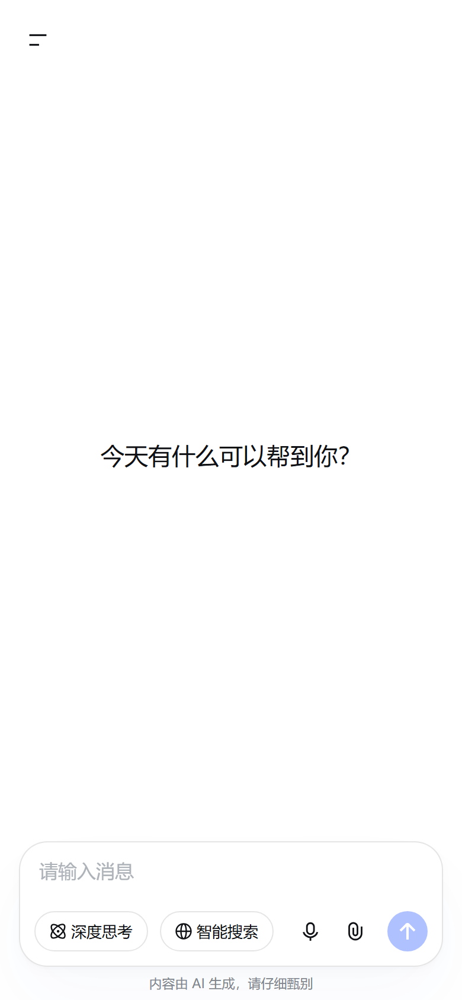
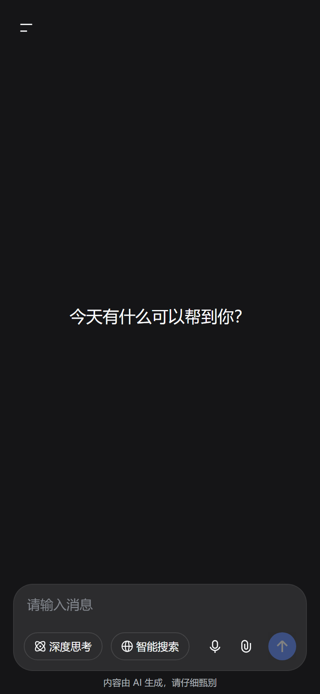

# Card Tree 手机版 · 可行性评估

> 评估对象：把 `D:\DSH\Talk_in_Tree\card-tree`（DSH 插件 dsh-card-tree v0.8.3）的「卡片树对话」做成手机版，
> UI 参照手机版 DeepSeek App，模型 API 不绑定 DeepSeek 官方。
> 结论日期：2026-11-16　评估人：lead（DSH agent）

---

## 0. 一句话结论

**可行，而且条件很好。** DeepSeek 官方在 2026-11-13 开源了完整聊天前端 `deepseek-ai/chat-demo`（MIT，React 18 + TS + CSS Modules，**静态前端、浏览器直连 API、移动端布局已实现**），
card-tree 里真正值钱的**卡片树上下文装配逻辑是 ~170 行纯函数**（`index.js:804-975`，不依赖 DSH，可几乎逐行搬到 TS）。
所以「手机版 + DeepSeek 手感 UI + 任意模型」不需要从零写，而是**拼装**：

```
chat-demo 的皮肤/组件/移动端壳  +  card-tree 的树语义与上下文预算  +  自写 provider 适配层
```

推荐形态：**手机优先的静态 Web App（PWA，可"添加到主屏幕"，后续一个 Capacitor 壳就能出 APK）**。
预估 **9–15 人日** 等效工作量（AI 协作开发约 3–5 个工作日），代码量 6–9k 行，其中约 2.5k 行来自 chat-demo 直接改造。

---

## 1. "手机版这个软件"到底要做成什么

card-tree 现在的形态是**桌面 DSH 里的一个插件面板**（中央页 + 侧栏图标 + 接管输入框），产品语义是：

- 一个项目里长一棵**卡片树**，每张卡 = 一次提问 + 一次回答；
- 从任意卡可以**深入**（子卡）/ **追问**（不新增节点，挂在卡下面）/ **发散**（兄弟卡）/ **独立**（脱离树）；
- 上下文 = 从根到父级的祖先链 + 被引用卡片 + 本卡 + 更早的追问，按 token 预算自动折叠/丢弃；
- 全览图（拖拽、改父级、建引用、删除、自动布局）；
- 只读工具白名单（read/grep/web_search…），最多 6 轮工具调用；
- 数据在 `~/.dsh/card-tree/state.json`。

手机版要保留的是**①②③⑤**，其中③是灵魂。工具（④）在纯前端 App 里没有（没有本机文件系统、没有 DSH 的 tool 运行时），这是唯一实质性能力缺失，见 §6。

---

## 2. 三条技术路线

| | A. 静态 Web App / PWA（推荐） | B. 继续做 DSH 插件，加移动端页 | C. React Native / Expo 原生 |
|---|---|---|---|
| 形态 | 手机浏览器打开 / 加到主屏 / 可打包 APK | 手机浏览器访问**跑着 DSH 的那台电脑** | 安装原生 App |
| UI 还原 DeepSeek | ★★★★★ chat-demo 现成（含移动端布局） | ★★★☆☆ 需要重写一套移动 UI，且塞进 DSH 壳里 | ★★★☆☆ 全部自己写 |
| 任意模型 | ★★★★☆ 自写适配层；浏览器直连有 CORS 风险 | ★★★★★ DSH 已有 provider 体系，白拿 | ★★★★☆ 同 A |
| 工具/搜索 | ★★☆☆☆ 无本地工具 | ★★★★★ 全都有 | ★★☆☆☆ 同 A |
| API Key 安全 | ★★★☆☆ 存本机（可加密存 IndexedDB） | ★★★★★ Key 在电脑上，不进手机 | ★★★☆☆ 可用系统钥匙串 |
| 离线/移动体验 | ★★★★☆ PWA 可离线缓存外壳 | ★★☆☆☆ 必须电脑在线 + 同网 | ★★★★★ 最好 |
| 工作量 | **中** | 中（但要装/改移动响应式插件） | **大**（1.5–2×） |
| 依赖 | 无（可托管在任何静态空间） | 必须能访问那台电脑（局域网/内网穿透） | 应用商店/侧载 |

**建议 A，并把 B 留作后续「连接模式」**：同一个前端，设置里多一个"后端地址"，把请求打到 DSH 上的 `/dsh-card-tree/send`（协议几乎一样，`index.js` 的 SSE 帧已就绪）。这样先用 A 拿到体验，之后想要工具/搜索再接 B，不用重写。
C 只在"要上架 + 重度使用"时才值得，A 的代码 90% 可被 Capacitor/RN 复用。

---

## 3. 推荐方案（A）的架构

```
┌──────────────── 手机浏览器（PWA） ────────────────┐
│ UI 层：chat-demo 改造（主题/图标/消息气泡/Markdown/│
│        KaTeX/Mermaid/抽屉/安全区/软键盘）          │
│ ────────────────────────────────────────────────  │
│ 领域层：Project / Card / FollowUp / Ref 树操作     │
│         上下文装配 planContext（从 index.js 移植）  │
│ ────────────────────────────────────────────────  │
│ 存储层：IndexedDB（idb）会话+附件+草稿 + 导入导出   │
│ ────────────────────────────────────────────────  │
│ 网关层：Provider 适配器                           │
│   ├ openai-compatible（OpenAI/DeepSeek/Kimi/智谱/  │
│   │  通义/硅基流动/OpenRouter/Ollama/vLLM…）      │
│   └ deepseek-anthropic（思考/联网/标题/文件上传）   │
│ 内部统一事件：start·thinking·delta·search·tool·   │
│              notice·done·aborted·error            │
└───────────────────────────────────────────────────┘
        │ 直连（多数）            │ 兜底：可选小代理
        ▼                         ▼
   各家 API（CORS 允许的）    Cloudflare Worker / Vercel Edge（~30 行）
```

**关键设计**：UI 只消费「内部统一事件」，永远不知道后面是哪家模型。换模型 = 换一个适配器 + 设置里一份 provider 预设，不改 UI。
这正是 chat-demo 已经做对的事（`src/services/api/parseEvent.ts` 把 DeepSeek 的 SSE 解析成内部事件）；我们要做的是**再加一个 `openai.ts`**，并把 `API_ORIGIN` 从构建期常量改成运行时设置。

---

## 4. UI 怎么做到"和手机版 DeepSeek 一样"

`deepseek-ai/chat-demo` 就是官方 App/网页前端 1:1 开源复刻，MIT 授权，可直接 fork。它的资产盘点（我已在本地 clone 通读）：

| 类别 | 文件 | 处理 |
|---|---|---|
| 设计 token | `src/app/theme.css`（12.5 KB）、`global.css` | **直接用**。和 card-tree/DSH 同为 `--dsw-alias-*` 命名，深浅色都齐 |
| 图标 | `src/components/base/icons.tsx`（60 KB 官方图标集） | **直接用** |
| 基础组件 | `Button/IconButton/Menu/Modal/Select/Toast/Tooltip/anchored.ts` | **直接用** |
| 消息渲染 | `messages/{MessageList,AssistantMessage,ReplyArea,UserMessage,BranchSwitcher,CopyButton}` | 改造：消息里的"分支"改成"卡片树位置/兄弟切换" |
| Markdown | `markdown/{Markdown,MarkdownAstRenderer,CodeBlock,MathFormula,MermaidDiagram}` + katex/mermaid/prism | **直接用**（公式、图表、代码高亮全免费） |
| 输入框 | `chatInput/{ChatInput,useVoiceInput,VoiceButton,Spectrum,DraftAttachments,DragMask}` | 改造：底部加"生长方式"四个按钮（深入/追问/发散/独立） |
| 移动端 | `app/viewport.ts`（visualViewport 跟随键盘）、`session/MobileHeader.tsx`、`sider/MobileSider` | **直接用**（软键盘、动态视口、抽屉都写好了） |
| 设置 | `settings/SettingsDialog.tsx`（17 KB）、`ApiKeyField` | 改造：多 provider、自定义 Base URL、模型列表、能力开关 |
| 多语言 | `i18n/{zh,en}.ts` | 直接用，加我们的新文案 |
| 存储 | `services/chat/db.ts`（IndexedDB）、`history/`（ZIP 导入导出 10 个文件） | 复用存储与导入导出模式，数据模型换成卡片树 |
| 会话/流式 | `services/chat/{store,reply,view,branches}.ts`（最重的 37 KB 部分） | **替换**为我们的树 store（这里不需要线性会话逻辑） |
| 语音 | `services/speech/*`、`services/api/speech.ts` | DeepSeek 的 ASR/TTS 换 provider 就没了；改为浏览器 Web Speech API / speechSynthesis 降级 |

还原度评估：**聊天页、输入框、抽屉、设置、深浅色、Markdown 排版约 90% 直接到位**；剩下 10% 是靠截图逐项比对（间距、圆角、字重、动画节奏）的微调，1 天左右。

### 4.1 本机实测截图（已构建 chat-demo 并渲染）

不是效果图，是在本机 `pnpm build` 后，用 Chrome DevTools Protocol 按 **390×844 / DPR 2 / 触摸** 真手机视口截的：

| 浅色 | 深色 |
|---|---|
|  |  |

这就是我们要的界面基底（汉堡菜单 → 抽屉、居中欢迎语、底部 composer 带「深度思考 / 智能搜索」开关、麦克风/附件/发送、底部署名行）。
卡片树要做的是在这个 shell 里换成「面包屑 + 卡片流」，并把「深度思考/智能搜索」两枚开关替换成「深入/追问/发散/独立」四种生长方式。

> 实测发现：设置弹窗（SettingsDialog）在 390px 宽下有溢出（弹窗宽度按桌面写死），移动端需要改一版全屏/底部 sheet 样式——已计入 M0。
唯一要重新设计的是**全览图**（§5）和**卡片树的导航信息架构**（面包屑/层级感），这两块 chat-demo 没有对应物。

> 提醒：DeepSeek 的视觉语言可以照着做，但**应用名不能用 "DeepSeek"、图标不能用它的 logo**（避免暗示官方）。自用无碍，公开分发时保留 chat-demo 的 MIT LICENSE 与版权声明即可。

---

## 5. 手机端交互重设计清单（这块是新增工作量的大头）

| 桌面行为 | 手机方案 |
|---|---|
| 三栏并排（树列表/详情/全览） | 单列栈式：**对话页 ← 树面板（抽屉/底部 sheet）**，面包屑「根 / 父卡 / 当前卡」常驻顶部，点面包屑跳层级 |
| 全览图（可拖拽画布） | 同一套布局算法（`services.layout` 可移植），交互换成：双指缩放 + 单指平移 + 点击聚焦 + **长按节点出菜单**（改父级/建引用/删除）。首屏自动 fit 到当前分支 |
| 悬停出操作按钮 | 长按 / 划动 / 右上角 ··· 菜单 |
| 追问列表展开 | 卡片内折叠区，默认收起，显示条数 |
| 引用线（虚线） | 同画布内绘制；手机上加"引用"页签按条展示 |
| 拖拽改父级 | 全览图长按→「移动到…」选择目标父卡（避免小屏拖拽误操作） |
| 输入框占用大屏 | 底部 composer，随卡状态切换：空卡=提问；有答案=默认追问；工具栏切生长模式 |
| 大段上下文统计 | 详情页小字显示「上下文 ≈ xx k / 折叠 n 张」 |

另需：`safe-area-inset` 适配、iOS 键盘顶起、下拉刷新禁用、横屏提示、PWA manifest + 图标 + Service Worker。

---

## 6. 多模型 API：能到什么程度

### 6.1 协议层

| 协议 | 覆盖 | 能力 |
|---|---|---|
| **OpenAI 兼容 `/chat/completions`（stream）** | OpenAI、DeepSeek、Kimi、智谱 GLM、通义 Qwen、硅基流动、OpenRouter、Groq、Ollama、LM Studio、vLLM… | 文本流、思考（多数家返回 `reasoning_content` 类字段，需按家映射）、工具调用（`tools`/`tool_calls`）、视觉（多模态模型） |
| **DeepSeek Anthropic 兼容 `/anthropic/v1/messages`** | DeepSeek 官方 | 思考块、联网搜索、标题生成、文件上传（files-api beta）——chat-demo 用的就是这条 |

做法：内部统一事件 + 两个适配器 + **provider 预设表**（每家一条：baseURL、模型列表、是否支持思考/搜索/视觉/文件、是否需要代理），用户点选即用，也允许"自定义 OpenAI 兼容端点"填 URL + Key + 模型名。

### 6.2 CORS：唯一需要提前验证的技术风险

- 浏览器直连能成的：DeepSeek 官方（chat-demo 本身就在浏览器跑通）、OpenAI、OpenRouter 等；
- 不确定的：部分国内厂商可能不返回 CORS 头或不允许 `Authorization` 预检 → 直连失败。
- 兜底方案（都便宜）：
  1. 前端内置"代理地址"设置项；
  2. 附一个 **Cloudflare Worker / Vercel Edge 30 行代理**（`/v1/*` → 目标域名 + 加 Key），5 分钟部署；
  3. 打包成 APK 后走原生 HTTP（Capacitor Http 插件），彻底没有 CORS。

### 6.3 能力降级策略

设置页按 provider 能力显示开关，不支持的直接隐藏：深度思考、联网搜索、标题自动生成、语音输入/朗读、文件上传。
语音可降级为浏览器自带能力（Android Chrome 的 `webkitSpeechRecognition`、`speechSynthesis` 朗读），不依赖 DeepSeek 服务。

### 6.4 安全

纯前端 App 的 Key 只能存在手机上（IndexedDB/localStorage）。提供：默认本地保存 + 明示风险 + 可选"代理模式"（Key 只放服务端）。
若之后接 B 路线（连 DSH 宿主），Key 完全不进手机。

---

## 7. 卡片树逻辑能复用多少

| 模块 | 现状 | 移植方式 |
|---|---|---|
| `estimateTokens` / `messageTokens` / `foldAnswer` | index.js:806-832 纯函数 | 逐行搬 TS（~30 行）|
| `planContext`（预算、折叠、丢弃、stats） | index.js:839-890 纯函数 | 逐行搬 TS（~50 行），只依赖 `resolvedRefs`/`ancestorChain` 两个本地 helper |
| `buildMessages` / `buildFlattenedMessages` | index.js:893-975 | 搬成"消息数组 → provider 请求体"的前置步骤（~80 行）|
| `buildSystem` | index.js:206 | 搬（提示词就是产品资产） |
| 树操作（reparent 防环、模式、兄弟顺序、引用上限 8） | index.js 路由层 | 重写成纯 reducer + IndexedDB 持久化 |
| 全览图布局算法 | client.js `services.layout` | 移植物（去掉 DOM 依赖） |
| SSE 帧协议 | index.js `/send` | 直接用同样的内部事件形状，前端 store 照 client.js 的解析改写 |
| 数据模型 | state.json schema | 换 IndexedDB 表结构，版本号 + **支持导入现有 state.json**（你已有 161 KB 真实数据：一个图论项目、6+ 卡、多条追问） |
| client.js 本身 | 4 千行、无 JSX、DSH ModuleLoader、桌面布局 | **不复用**：只挖逻辑与交互思路 |

结论：**树语义 + 上下文预算 100% 可移植；UI 层用 chat-demo 重写**。这是最省力的组合。

---

## 8. 风险与对策

| 风险 | 等级 | 对策 |
|---|---|---|
| 某家 API 浏览器直连被 CORS 拦 | 中 | 预设已验证 provider + 自定义代理 + 30 行 Worker；APK 化彻底解决 |
| 纯前端无本地工具（read/grep/搜索） | 中 | v1 砍掉；联网搜索用 provider 原生能力或代理加搜索 API；后续接 B 路线补回 |
| 手机浏览器 API Key 泄露 | 中 | 本地明文的风险提示 + 代理模式 + 后续钥匙串 |
| 全览图小屏难用 | 中 | 长按菜单 + fit-to-branch + 双指缩放，投入 2–3 天专项打磨 |
| 切后台流式被系统挂起 | 低 | 回来检测到断流 → 显示"已中断，可重试/续写"，与桌面版一致 |
| 大上下文在手机上滚动卡顿 | 低 | chat-demo 已有 `useThrottleMarkdownRender`（节流渲染） |
| 数据迁移丢卡 | 低 | 导入前备份、schema 版本号、导入失败整批回滚 |
| 构建链异常（rspack 2 / TS 7 / React 18 / Node 24） | 低 | 正在本机实测 `pnpm install && pnpm build`（见 §10 验证项） |
| 品牌合规 | 低 | 不用 DeepSeek 名称/logo；保留 MIT 声明；自用无风险 |

---

## 9. 里程碑与工作量

| 阶段 | 内容 | 验收标准 | 人日 |
|---|---|---|---|
| **M0 骨架** | 从 chat-demo 剥出 UI 基底（theme/icons/base/markdown/i18n），建 TS 工程，删掉线性会话 | `pnpm dev` 出 DeepSeek 风格页面，构建通过 | 0.5–1 |
| **M1 单卡闭环** | 数据模型 + IndexedDB + 一个 provider 打通流式 + 卡片详情页 | 手机上能提问、看到流式回答、刷新不丢 | 1.5–2 |
| **M2 树语义** | 四种生长模式、追问、分支重答、上下文预算移植 | 与桌面版行为一致（含 token 统计） | 2 |
| **M3 树浏览** | 面包屑、子卡、树面板、全览图手机版（缩放/长按/改父级/引用） | 6 寸屏可完成全部树操作 | 2–3 |
| **M4 多模型** | provider 适配器（2 种协议）+ 预设表 + 设置页 + 能力开关 | 换 provider 不改代码；错误提示可读 | 1–2 |
| **M5 PWA** | manifest/SW/图标/安全区/键盘/深浅色/导入导出 state.json + ZIP | 加到主屏后像 App；旧数据能导入 | 1–1.5 |
| **M6（可选）APK** | Capacitor 壳 + 原生 HTTP（同时解决 CORS） | 装机可跑 | 0.5–1 |
| **M7 验证** | 迁移回归、多 provider 冒烟、Lighthouse、真机走查 | 清单全绿 | 0.5–1 |
| 合计 | | | **9–15 人日**（AI 协作约 3–5 个工作日） |

代码量估算：6–9k 行（其中 ~2.5k 行从 chat-demo 改编）。

---

## 10. 已完成的验证

- [x] 通读 card-tree 两半边（`index.js` 1953 行 / `client.js` 4182 行）+ `docs/ARCHITECTURE.md`，确认上下文装配是纯逻辑、树语义清晰、数据 schema 完整；
- [x] 通读 DeepSeek 开源前端 `deepseek-ai/chat-demo` 全量源码（146 个文件），确认：MIT、静态前端直连 API、移动端布局（视口/键盘/抽屉）已实现、Markdown/公式/Mermaid/代码高亮/深浅色齐全；
- [x] 本机环境：Node v24.16.0 / pnpm 11.22.0 满足 chat-demo 的 Node ≥22.12 要求；
- [x] **实测构建通过**：`pnpm install` 退出码 0（npmjs 源），`NODE_ENV=production pnpm rspack build` → `Rspack compiled successfully in 836 ms`；产物 `dist/main.js` 464 KB、`dist/main.css` 87 KB、KaTeX 字体分包，全量 4.3 MB（含懒加载分块）；
- [x] **实测手机视口渲染**：CDP 以 390×844/DPR2 截图，浅色 + 深色均正常（见 §4.1）；
- [x] 发现并在文档中记录：SettingsDialog 在 390px 宽溢出，移动端需重做样式（M0 内解决）；
- [ ] 真机（iOS Safari / Android Chrome）走查 —— M5 阶段必须做，模拟器不能完全替代。

---

## 11. 需要你拍板的三件事

1. **形态**：A 手机网页/PWA（推荐，先能用）→ 后续是否要 APK 壳？
2. **模型来源**：默认接哪家/哪几家？（官方 DeepSeek / OpenRouter / 硅基流动 / Kimi / 智谱 / 本地 Ollama…可多选，做成预设）
3. **要不要"工具 + 联网搜索"**：v1 只做纯对话树（快），还是直接上 B 路线接你电脑上的 DSH 宿主（功能全但要电脑在线）？

拍板后我可以直接从 M0–M2 动手，先给你一个手机上能装的可用版本（含旧卡片导入）。
